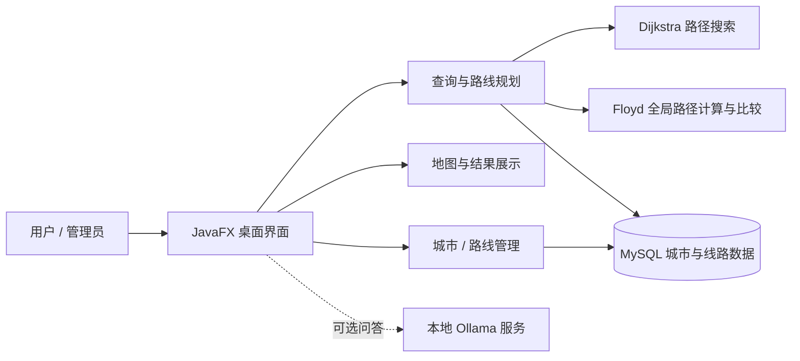

# 全国交通咨询模拟系统

### 基于 Java 与 JavaFX 的交通线路查询和路径规划课程设计

**把城市和班次组织成可查询的交通网络，让路径选择从“凭经验”变成“有依据”。**

---

## 项目简介

全国交通咨询模拟系统是一项数据结构课程设计。系统将城市视为图中的顶点，将城市间的列车、航班等班次视为带有时间与费用信息的边，为用户提供线路检索和多目标路线规划，并通过可视化界面展示查询结果。

项目围绕图的建模与最短路径算法展开，同时结合 JavaFX 桌面界面和 MySQL 数据存储。根据项目作者提供的信息，该作品曾由学院推选为优秀课程设计作品。

> 本项目用于课程设计与算法演示。线路、票价和班次信息取决于项目数据库，不代表实时售票或实时交通信息。

## 项目亮点

- **双算法协同**：使用 Dijkstra 与 Floyd 处理路径规划，并对路线结果进行交叉比较。
- **多目标查询**：围绕用时、费用和换乘次数提供不同的路线选择策略。
- **考虑班次时刻**：路线数据包含出发、到达、旅行耗时和费用；换乘时需要计算等待时间。
- **地图交互**：在地图上选择城市、查看交通网络并高亮规划路线。
- **桌面端完整流程**：覆盖登录、路线检索、路线管理和城市信息管理等功能。
- **便于课程讲解**：将图、路径算法、数据库和 GUI 串成一个可操作的应用实例。

## 功能概览

| 模块 | 功能 |
| --- | --- |
| 路径规划 | 输入起点与终点，按最短用时、最低费用或较少换乘等策略查询路线 |
| 路线详情 | 展示分段班次、出发与到达时间、等待时间、累计用时和费用 |
| 地图展示 | 查看城市分布与线路，在地图上选择城市并显示查询路径 |
| 路线检索 | 按城市或车次等关键词筛选线路信息 |
| 信息管理 | 管理城市与路线记录，并刷新界面中的数据 |
| AI 助手 | 项目说明书描述了基于本地 Ollama 的辅助问答功能；此功能依赖本地模型服务配置 |

## 算法与数据结构

### 图模型

- 城市对应顶点。
- 城市间的班次对应有向边；边上保存交通方式、班次编号、出发与到达时刻、旅行天数及费用等信息。
- 同一对城市可以存在多条不同班次或交通方式的边。
- 路线计算需要结合班次可乘时间与换乘等待时间，不能只把每段行程的车上时间简单相加。

### Dijkstra 与 Floyd

系统将 Dijkstra 和 Floyd 用于不同角度的路径计算与结果比较。Dijkstra 面向给定起点的路线搜索；Floyd 通过逐步放宽中间顶点，计算顶点对之间的路径结果。系统按查询策略使用不同的权值或代价，并在可达时对两种算法得到的路线指标进行比较。

| 算法 | 典型用途 | 典型复杂度 |
| --- | --- | --- |
| Dijkstra | 从指定出发城市计算到其他城市的最优路径；适合单起点查询 | 邻接矩阵实现通常为 `O(V²)`；使用邻接表和优先队列时通常为 `O((V + E) log V)` |
| Floyd | 计算所有城市对之间的最短路径；适合小规模网络和结果校验 | 时间 `O(V³)`，空间 `O(V²)` |

其中 `V` 为城市数，`E` 为线路数。对于包含具体发车时刻的路径规划，算法权值还需要正确表示等待、跨日和旅行时间。项目说明书中也将 Dijkstra 与 Floyd 的输出用于交叉验证；两种算法的比较是课程设计中的重要教学点。

### 路径选择指标

- **最短用时**：累计行程时间与必要的换乘等待时间。
- **最低费用**：各段票价之和。
- **换乘次数**：路径中连续班次之间的衔接次数。

在不同指标下，“最优路线”可能不同。系统分别计算并呈现结果，便于用户按实际偏好选择。

## 技术结构

**主要技术**：Java、JavaFX、图与最短路径算法、MySQL；项目说明书还记录了本地 Ollama 辅助问答模块。

## 使用说明

本仓库文档用于介绍项目设计。运行完整程序需要配套 Java 源码、JavaFX 运行环境及 MySQL 数据库，并按项目自身的数据库结构配置连接。若启用 AI 助手，还需本地 Ollama 服务及相应模型。

当前说明书与源码保存在项目资料目录中；本 README 描述系统设计和功能，不包含数据库密码、个人学号等个人信息。实际运行方式应以随项目源码提供的配置和说明为准。

## 课程设计价值

本项目把数据结构课程中的图与最短路径问题放进交通咨询场景中，要求综合处理多重边、不同权值、班次时刻和换乘等待等因素。界面、数据库与路线算法共同构成完整应用，也让 Dijkstra 与 Floyd 的适用场景、复杂度和结果差异能够直观展示。

## 致谢

感谢课程指导与项目成员在需求分析、算法设计、界面实现和测试整理中的投入。

